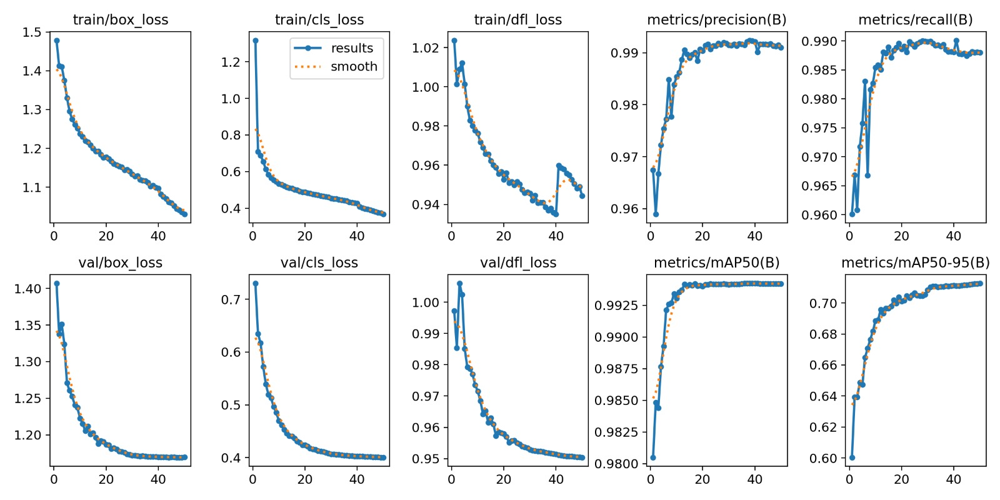
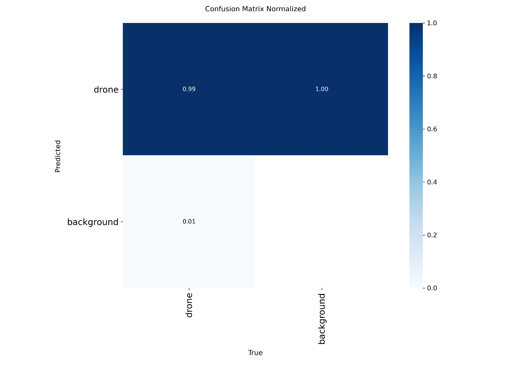
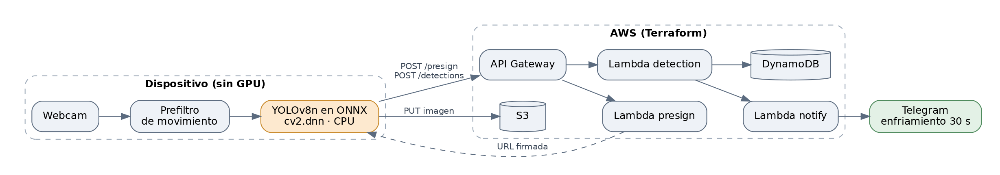

# Detección de drones con YOLOv8 y backend serverless en AWS

Sistema de detección de drones en video mediante visión por computadora. Un modelo YOLOv8n, entrenado sobre el canal visible del dataset Anti-UAV-RGBT, corre en un computador portátil sin GPU (ONNX con `cv2.dnn`) y reporta las detecciones a un backend serverless en AWS, que guarda la evidencia y notifica por Telegram.

> Proyecto desarrollado en pareja por Camilo Millán y Santiago Castellanos para la asignatura de Procesamiento de Imágenes (2026). Este repositorio es una copia del repositorio privado del proyecto, publicada con autorización; de la historia se retiraron los archivos de trabajo interno. La sección [Participación](#participación) detalla qué parte desarrolló cada uno.



## Resultados del modelo

| Métrica (partición de validación) | Valor |
| --- | --- |
| Arquitectura | YOLOv8n (3,2 M parámetros), una clase: `drone` |
| Precisión | 99,1 % |
| Recall | 98,8 % |
| mAP@0.5 | 99,4 % |
| mAP@0.5:0.95 | 71,3 % |
| Entrada | 640 × 640 RGB |

El mAP@0.5 casi perfecto indica que el modelo encuentra los drones; el mAP@0.5:0.95 más bajo muestra que el ajuste fino de la caja sigue siendo el punto débil, sobre todo con drones pequeños y lejanos.



## Arquitectura



- **Inferencia local:** captura de webcam, prefiltro de movimiento (ahorra cerca del 85 % de CPU) y modelo ONNX con `cv2.dnn`, ~10 FPS en CPU.
- **Nube:** AWS Lambda, API Gateway, S3 y DynamoDB, desplegados con Terraform.

## Participación

**Santiago Castellanos** — modelo de detección:

- Planeación del modelo y estudio de alternativas antes de elegir YOLOv8n.
- Análisis y planteamiento del procesamiento de imágenes: construcción del dataset en formato YOLO a partir de los videos de Anti-UAV-RGBT (un cuadro de cada cinco, con particiones de entrenamiento, validación y prueba) y estudio del preprocesado.
- Entrenamiento y evaluación del modelo final: YOLOv8n preentrenado, 50 épocas, entrada RGB de 640 × 640.
- En una iteración posterior, comparación entre el preprocesado manual a escala de grises y la aumentación de datos de YOLO ajustada a objetos pequeños; ese trabajo está en la rama [`TrainingModelUpdates`](../../tree/TrainingModelUpdates).

**Camilo Millán** — arquitectura del sistema e infraestructura en la nube:

- Diseño de la arquitectura híbrida entre el dispositivo de captura y la nube, pensada para hardware limitado como una Raspberry Pi sin GPU.
- Pipeline de inferencia propio con ONNX y `cv2.dnn`: preprocesamiento con *letterboxing*, inferencia, supresión de no máximos y posprocesamiento, más el prefiltro de movimiento que reduce el uso de CPU.
- Backend serverless en AWS desplegado con Terraform: API Gateway, funciones Lambda para URLs firmadas, registro de detecciones y notificaciones, almacenamiento en S3 y DynamoDB.
- Bot de Telegram con control de enfriamiento para evitar alertas repetidas.

## Estructura

```
inference/   detección en webcam e inferencia sobre video (Ultralytics y ONNX)
model/       modelo entrenado (best.pt, best.onnx) y exportación a ONNX
training/    construcción del dataset, entrenamiento y resultados
lambdas/     funciones presign, detection y notify
terraform/   infraestructura en AWS
docs/        documento técnico y arquitectura
```

## Cómo ejecutarlo

Requisitos: Python 3.10+, `pip install -r requirements.txt`. Para la parte en la nube, Terraform ≥ 1.5, AWS CLI configurado y un bot de Telegram.

```bash
# Detección local con la webcam (q: salir, m: activar o desactivar el filtro de movimiento)
python inference/detect_webcam.py

# Detección con reporte a AWS
python inference/detect_webcam.py --api-url https://<api-id>.execute-api.us-east-1.amazonaws.com/v1 --device-id laptop-01
```

Despliegue de la infraestructura: ver [terraform/README.md](terraform/README.md).

## Alcance

Proyecto académico concluido. Quedaron implementados la detección en tiempo real, el prefiltro de movimiento, la infraestructura en AWS y las notificaciones. No se completaron la validación ONNX contra Ultralytics, la integración de extremo a extremo y las pruebas de estabilidad.
